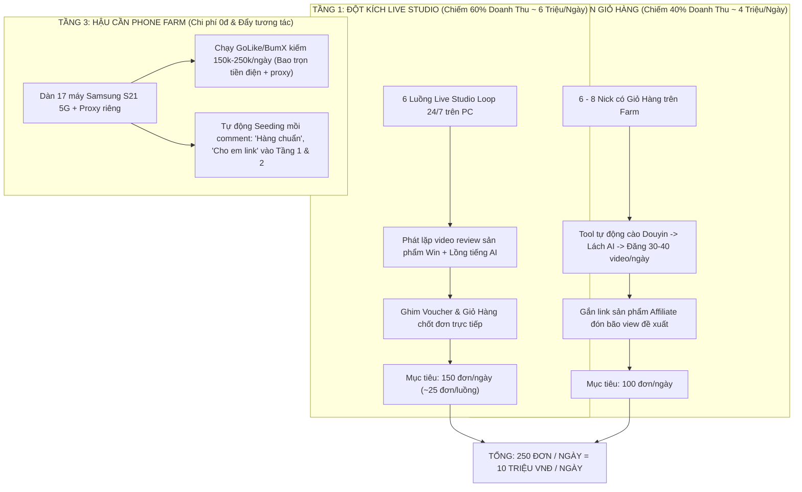
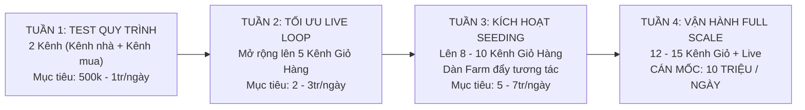

# 🚀 MASTER BLUEPRINT: CHIẾN LƯỢC KIẾM 10 TRIỆU VNĐ / NGÀY VỚI TIKTOK FARM & LIVE STUDIO

Tài liệu này là bản kế hoạch tổng thể (Master Strategy) dành riêng cho hệ thống **Phone Farm 17 máy + TikTok Shop Affiliate + TikTok Live Studio tự động**.

---

## 🎯 1. BÀI TOÁN CON SỐ & CHỈ SỐ CỐT LÕI (UNIT ECONOMICS)

Để kiếm ròng **10.000.000 VNĐ / ngày** (tương đương **300.000.000 VNĐ / tháng**), hệ thống cần đạt:

| Chỉ số | Mục tiêu / Ngày | Ghi chú thực tế |
| :--- | :---: | :--- |
| **Lợi nhuận hoa hồng** | **10.000.000 VNĐ** | Hoa hồng Affiliate trả về ví TikTok Shop |
| **Hoa hồng trung bình / đơn** | **40.000 VNĐ** | Tỷ lệ hoa hồng 15% - 20% trên giá trị đơn 200.000đ |
| **Tổng số đơn hàng cần bán** | **~250 đơn / ngày** | Chia đều cho 2 mũi nhọn (Live Studio + Video ngắn) |
| **Tổng GMV (Giá trị hàng bán)** | **~50.000.000 VNĐ** | Bạn không cần bỏ vốn nhập hàng, Shop lo đóng gói & giao hàng |

---

## 🏗️ 2. KIẾN TRÚC VẬN HÀNH 3 TẦNG (3-TIER SYSTEM)

---

## ⚔️ 3. CHI TIẾT 2 MŨI NHỌN TẤN CÔNG

### 🔥 Mũi Nhọn 1: Live Studio Tự Động (Cỗ máy in tiền 6 triệu/ngày)
* **Nguyên lý:** Khách hàng lướt xem Livestream có tỷ lệ bấm vào giỏ hàng mua ngay cao gấp 5–8 lần so với xem video ngắn vì họ thấy ngay voucher giảm giá và số lượng còn ít.
* **Cách vận hành tự động:**
  1. Chọn **3 – 5 sản phẩm Win** (tiện ích gia đình, đồ thông minh, thời trang hot).
  2. Dựng 1 đoạn video review chi tiết sản phẩm dài **15 – 25 phút** (cắt ghép cảnh test thực tế từ Douyin, lồng tiếng AI tiếng Việt nói cuốn, dồn dập).
  3. Cài phần mềm **TikTok Live Studio** trên máy tính $\rightarrow$ Chọn chế độ phát vòng lặp (Loop) luồng video này liên tục **6 – 12 tiếng/ngày**.
  4. Ghim sản phẩm và cài đặt nút Voucher độc quyền.

### 🎬 Mũi Nhọn 2: Ma Trận Video Ngắn Gắn Giỏ Hàng (4 triệu/ngày)
* **Nguyên lý:** "Đánh số lượng để đón đề xuất". Một video cắn xu hướng 100k view có thể mang về ngay 80 – 150 đơn hàng trong vòng 24 giờ.
* **Quy trình tự động hóa:**
  1. Tool tự động quét các video Douyin đạt trên 50.000 tim trong tuần qua.
  2. Bộ lọc AI tự động lách bản quyền: lật gương, đổi bitrate, chèn nhạc nền xu hướng Việt Nam, gắn phụ đề tiếng Việt.
  3. Tự động đăng tải vào các khung giờ vàng: **11h30 – 12h30**, **18h30 – 19h30**, **21h00 – 22h00**.

---

## 📦 4. BÍ QUYẾT CHỌN "SẢN PHẨM WIN" (QUYẾT ĐỊNH 70% THẮNG THUA)

Tuyệt đối không bán sản phẩm theo cảm tính. Chỉ chọn sản phẩm đáp ứng đủ **4 tiêu chí vàng**:
1. **Giá bán bình dân (Dễ chốt):** Từ **99.000đ đến 249.000đ** (người mua không cần đắn đo, xem là bấm mua ngay).
2. **Hoa hồng cao:** Tối thiểu từ **15% đến 22%** (mỗi đơn đút túi 30k – 50k).
3. **Tính "Thị giác" (Visual Effect) cao:** Nhìn thấy công dụng ngay trong 3 giây đầu (ví dụ: máy hút bụi cầm tay hút sạch bụi sofa, keo dán siêu dính vá mọi lỗ thủng, dao bào gọt đa năng...).
4. **Shop uy tín:** Kho tại Việt Nam, giao hàng 2–3 ngày, tỷ lệ đánh giá shop $\ge$ 4.5 sao và có sẵn freeship.

---

## 📅 5. LỘ TRÌNH 4 TUẦN TIẾN TỚI 10 TRIỆU / NGÀY

### Tuần 1: Chạy trơn tru 2 kênh đầu tiên (Kênh nhà + Kênh mua 150k)
- Đăng nhập kênh mua 150k vào Máy 10 (đã có Proxy riêng).
- Cắm Live Studio chạy thử luồng đầu tiên trên máy tính.
- Đăng 3 video/ngày gắn link sản phẩm Win.
- **Mục tiêu:** Nổ 15 – 25 đơn hàng đầu tiên (thu hồi vốn mua nick ngay trong 3 ngày).

### Tuần 2: Nâng lên 5 kênh có Giỏ Hàng
- Trích lãi từ Tuần 1 mua thêm 3 nick giỏ hàng + live studio.
- Chạy song song 3 luồng Live Studio trên PC.
- **Mục tiêu:** Đạt 60 – 80 đơn/ngày (~2 – 3 triệu/ngày).

### Tuần 3: Kích hoạt toàn bộ Phone Farm hậu cần
- 7 máy clone trên Phone Farm chạy GoLike/BumX tự động (trang trải toàn bộ tiền điện và proxy).
- Cài script tự động cho các máy clone nhảy vào Seeding comment đẩy top trên các video và phiên live của kênh chính.
- **Mục tiêu:** Đạt 120 – 160 đơn/ngày (~5 – 7 triệu/ngày).

### Tuần 4: Chạy toàn diện Full Scale
- Vận hành 12 – 15 nick Giỏ Hàng & Live Studio.
- Đạt mốc **250 đơn hàng / ngày** $\rightarrow$ **Cán mốc 10.000.000 VNĐ / ngày**.

---

## 🛡️ 6. NGUYÊN TẮC BẢO VỆ TÀI SẢN FARM
- **Mỗi máy 1 Proxy riêng biệt:** Tuyệt đối không để chung IP, tránh bị TikTok quét liên đới khi có 1 nick vi phạm.
- **Đổi mật khẩu đồng bộ:** Mọi nick vào farm đều đổi về mật khẩu chuẩn (`MinhFarm@2026!`) và lưu trữ vào file Excel hệ thống.
- **Không chạy GoLike trên nick bán hàng:** Giữ tệp tài khoản bán hàng luôn sạch sẽ 100%.
